# ⚡ STARKEX — Fully Onchain Central Limit Order Book (CLOB)

> **Transparent. Trustless. Onchain. Always.**  
> An onchain Central Limit Order Book where the smart contract alone stores orders, enforces price-time FIFO matching, holds non-custodial escrow, and settles trades atomically.

[](https://vercel.com)
[](https://www.typescriptlang.org/)
[](https://react.dev/)
[](https://vitejs.dev/)
[](https://starknet.io/)

---

## 🌟 Overview

Most decentralized exchanges today rely on **Automated Market Makers (AMMs)** with high slippage, or **hybrid offchain relayers** (like 0x or dYdX) that require trusting centralized sequencers for order matching.

**STARKEX** eliminates intermediaries by placing the **entire CLOB lifecycle onchain**:
1. **Non-Custodial Escrow**: Tokens are locked into the smart contract before orders rest on the book.
2. **Strict FIFO Price-Time Priority**: Fair ordering with zero MEV front-running.
3. **Maker-Price Execution**: Takers cross at the resting order's price, with any price improvement refunded automatically in the same atomic transaction.
4. **Exact Integer Math**: Guarantees zero rounding dust (`LOT_SIZE = 1e15`, `TICK_SIZE = 1e4`).

---

## 📸 Key Interfaces & Features

### 1. Spot Trading Desk
* **Live Candlestick Chart**: Multi-timeframe viewer (`1m`, `5m`, `15m`, `1h`, `4h`, `1D`) with crosshairs, indicators, and snapshot capture.
* **Level-2 Order Book Widget**: Real-time bid and ask levels with depth bars and spread calculation.
* **7-Step Interactive Demo Lifecycle**: Step-by-step interactive workflow demonstrating order placement, crossing, matching at maker price, partial fill, and cancellation.
* **Custom Limit Order Form**: Test custom Buy/Sell orders that calculate required escrow and indicate whether an order crosses resting liquidity or rests on the book.

### 2. Level-2 Order Book & Market Depth View
* Visual **SVG Cumulative Market Depth Chart** (Green Bids curve vs Red Asks curve).
* Order book imbalance ratio (e.g. 58% Bids vs 42% Asks).
* Split Bids and Asks depth tables with one-click **"Buy At Ask" / "Sell At Bid"** execution.

### 3. Trade History & Audit Explorer
* Filterable activity feed (`ALL`, `BUY`, `SELL`, `CANCEL`).
* Transaction hash records with simulated Starknet block explorer triggers.
* One-click **Export to CSV** for full audit trails.

### 4. Portfolio & Testnet Faucet Manager
* Dual-account view: switch between **User A (Seller / Maker)** and **User B (Buyer / Taker)**.
* Live balance calculation: Available Wallet Balance + Locked Contract Escrow = Total Net Worth.
* **Interactive Faucets**: Instantly mint `+10.00 DEMO` or `+1,000 tUSD` for testing.
* **Smart Contract Escrow Audit**: Inspect locked allocations with an on-demand **"Cancel & Unlock Escrow"** button.

### 5. DEX Protocol Analytics
* Real-time metrics: 24h Volume, Total Value Locked (TVL), Trade count.
* Gas cost comparison: Starknet ZK-Rollup (<$0.001) vs Ethereum L1 (~$14.20).
* Architecture comparison matrix: STARKEX vs Offchain Relayers vs AMMs.

### 6. Cairo / Solidity Smart Contract Documentation
* Formal specifications of the 6-step settlement lifecycle.
* Contract interface references (`placeOrder`, `cancelOrder`, events).
* Mathematical invariants and precision rules.

---

## 🔄 The 6-Step Escrow & Settlement Lifecycle

```mermaid
sequenceDiagram
    autonumber
    actor A as User A (Seller)
    actor B as User B (Buyer)
    participant OB as OrderBook Contract
    participant T as ERC-20 Tokens (DEMO / tUSD)

    A->>OB: placeOrder(SELL, 100 tUSD, 1.0 DEMO)
    OB->>T: Escrow 1.0 DEMO from User A
    OB-->>A: OrderPlaced (Resting Ask @ 100)

    B->>OB: placeOrder(BUY, 105 tUSD, 0.4 DEMO)
    OB->>T: Escrow 42 tUSD (0.4 × 105 max limit)
    
    rect rgb(20, 25, 30)
    Note over OB: Match Engine: 105 crosses 100.<br/>Executes at Maker Price (100 tUSD).
    OB->>T: Transfer 40 tUSD to User A
    OB->>T: Transfer 0.4 DEMO to User B
    OB->>T: Refund 2 tUSD Price Improvement to User B
    OB-->>B: Emit Trade(0.4 DEMO @ 100)
    end

    Note over OB: 0.6 DEMO remains open at ask (100 tUSD)
    A->>OB: cancelOrder(remaining 0.6 DEMO)
    OB->>T: Return 0.6 DEMO back to User A
    OB-->>A: Emit OrderCancelled
```



---

## 🧮 Mathematical Precision & Units

To eliminate rounding errors and dust exploits:
- **`LOT_SIZE`** = $10^{15}$ (Minimum quantity step = 0.001 DEMO)
- **`TICK_SIZE`** = $10^{4}$ (Minimum price step = 0.01 tUSD)
- **`quoteAmount`** = $\frac{\text{qty} \times \text{price}}{10^{18}}$
- Every trade and partial fill results in an exact integer representation with zero rounding direction ambiguity.

---

## 📂 Project Structure

```text
STARKEX/
├── .gitignore               # Git ignore rules (node_modules, pngs, docs)
├── README.md                # Project documentation & overview
└── web/                     # Web application (React + Vite + TypeScript)
    ├── index.html           # HTML entry point with dark terminal viewport meta
    ├── package.json         # Scripts and project dependencies
    ├── vite.config.ts       # Vite build configuration
    ├── tsconfig.json        # TypeScript configuration
    └── src/
        ├── App.tsx          # Full trading desk, state engine & multi-tab views
        ├── index.css        # Professional dark terminal CSS design system
        └── main.tsx         # Application root mount
```

---

## 🚀 Getting Started

### Prerequisites
- [Node.js](https://nodejs.org/) (v18 or higher recommended)
- `npm` or `pnpm`

### Installation & Setup

1. **Clone the repository:**
   ```bash
   git clone https://github.com/KANISHQ09/STARKEX.git
   cd STARKEX/web
   ```

2. **Install dependencies:**
   ```bash
   npm install
   ```

3. **Start the local development server:**
   ```bash
   npm run dev
   ```
   Open [http://localhost:5173](http://localhost:5173) in your browser.

4. **Build for production:**
   ```bash
   npm run build
   ```

---

## 🌐 Deployment (Vercel)

This project is optimized for instant deployment on Vercel:
- **Framework Preset:** Vite
- **Root Directory:** `web`
- **Build Command:** `npm run build`
- **Output Directory:** `dist`

---

## 📄 License

MIT License. Built for the **Starknet Onchain Finance & Trading** track.
